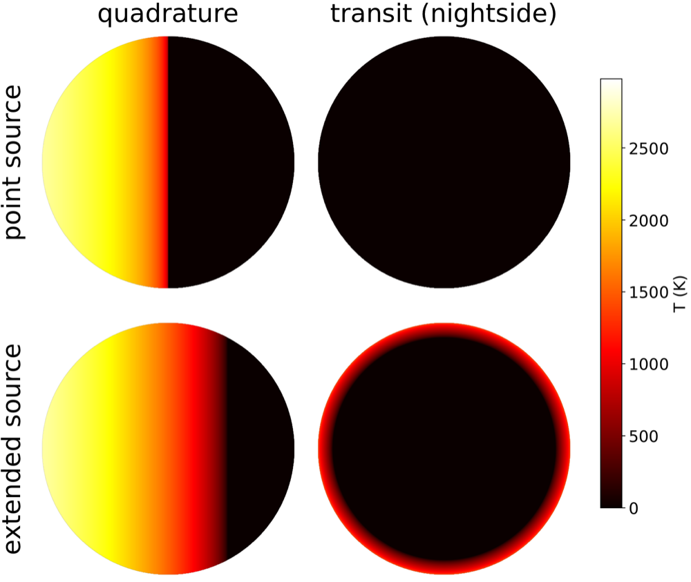

# HyperPhase

Phase curves of rocky exoplanets that orbit so close to their star that it can no longer be treated as a point source.

At $2 < a/R_\star < 3$ the star subtends an angular radius of 20°–30° as seen from the planet and illuminates two thirds to three quarters of its
surface, so a bare rock emits from beyond the classical terminator. HyperPhase computes the irradiance of the extended stellar disk
("hyper-illumination"), the resulting surface-temperature maps, and thermal and reflected phase curves in the JWST bands. It then quantifies
what the standard point-source model, fitted with a free Bond albedo and heat redistribution, makes of such a phase curve: a spurious heat
redistribution and an albedo biased low. The code covers noiseless fits with Fisher uncertainties and predicted Bayes factors, robustness to
nuisance parameters, and nested-sampling retrievals of simulated observations.

<p align="center">
  
</p>

*Surface temperature of the bare rock TOI-2431 b ($a/R_\star = 2.08$, Bond albedo 0.2) for a point-source star (top) and the extended star
(bottom), seen edge-on at quadrature (left) and at transit (right). The extended star heats a ring beyond the terminator, which is visible even when
the nightside faces the observer.*

This repository accompanies the paper **Spiller, Zieba & Wordsworth (in prep.), *Hyper-Illumination Mimics Heat Redistribution in JWST
Phase Curves of Rocky Planets Closest to Their Stars***. It was developed during J. Spiller's MSc thesis at ETH Zurich and Harvard University,
supervised by Sebastian Zieba, Robin Wordsworth and Sascha Quanz.

## Installation

```bash
git clone https://github.com/JonasSpiller/HyperPhase.git
cd HyperPhase
conda env create -f environment.yml    # Python 3.11 with the package versions of the paper; builds fSPIDERMAN and runs pip install -e .
conda activate hyperphase
```

The thermal phase curves use [fSPIDERMAN](https://github.com/JonasSpiller/fSPIDERMAN), a fork of SPIDERMAN (Louden & Kreidberg 2018) with
fixes for numpy ≥ 2, a faster light curve, a corrected band integration and a temperature-map interpolation that keeps a 0 K nightside at
0 K. It is a C extension, so building it needs a C compiler. To use an existing environment instead, install fSPIDERMAN from its repository
and this repository with `pip install -e .` (editable: the modules find the filter curves, stellar spectra and noise cache relative to the
repository).

Data that are not in the repository:

- **Stellar spectra.** By default (`stellar_model="newera"`) the planet-to-star contrast is normalised by NewEra model spectra
  (Hauschildt et al. 2025) at each host's $T_{\rm eff}$, $\log g$ and [Fe/H]. This needs a 113 MB spectral cube that is not in the
  repository: build it once with `Stellar Model/NewEra/build_newera.ipynb` from the NewEra JWST product
  ([doi:10.25592/uhhfdm.18108](https://doi.org/10.25592/uhhfdm.18108), about 12 GB). Without it, pass `stellar_model="blackbody"`.
- **Noise levels.** `Stellar Model/Pandexo/pandexo_cache.csv` holds the PandExo precision of the planets and bands of the paper for
  PandExo and Pandeia 2026.7. Other planets, bands or versions run PandExo, which needs the Pandeia reference data (`pandeia_refdata`) and
  the CDBS files (`PYSYN_CDBS`).

## Quickstart

```python
import matplotlib.pyplot as plt
from HItargets_utils import hi_planets_by_name, filter_lambda, filter_loc
from hyperillumination_phasecurve_utils import full_PhaseCurve

planet = hi_planets_by_name("TOI-2431 b")   # the paper's parameters of TOI-2431 b
band = "MIRI/LRS"
for model, label in (("hyperillum", "extended source"), ("naive", "point source")):
    # a bare rock with Bond albedo 0.2; stellar_model="blackbody" runs without the NewEra stellar spectra (see Installation)
    t, flux, depth = full_PhaseCurve(planet, filter_lambda(band), filter_path=filter_loc(band),
                                     insolation_model=model, A_B=0.2, stellar_model="blackbody")
    plt.plot(t / planet.period, (flux - 1) * 1e6, label=f"{label}: occultation depth {depth:.0f} ppm")
plt.ylim(-50, 250); plt.xlabel("orbital phase"); plt.ylabel("relative flux [ppm]"); plt.legend(); plt.show()
```

The insolation models are `"hyperillum"` (extended star), `"naive"` (point source) and `"naive_redist"` (point source with the heat
redistribution $F$ of Kreidberg & Loeb 2016, passed as `F=`). The notebooks in `Hyperillumination/` show the irradiance, the temperature
maps and the thermal and reflected curves step by step.

## Repository layout

| Folder | Contents |
|---|---|
| `Utilities/` | The code. `hyperillumination_utils.py`: extended-source and point-source irradiance, heat redistribution, temperature maps. `hyperillumination_phasecurve_utils.py`: thermal (fSPIDERMAN) and reflected phase curves, stellar band fluxes, the model of the fits. `astro_utils.py`: orbits, Planck functions, brightness temperatures, stellar spectra, Roche limits. `newera_utils.py`: the NewEra spectral cube. `batman_utils.py`: transits and occultations with batman. `HItargets_utils.py`: planet parameters (NASA Exoplanet Archive and a curated table with one published source per planet), instrument bands, noise levels, the baseline settings. `simple_bias_analysis.py`: noiseless fits, Fisher uncertainties, evidence predictions, nuisance parameters, bias maps. `dynesty_utils.py`: simulated observations, likelihoods, nested-sampling retrievals. |
| `Hyperillumination/` | The forward model: irradiance and illumination zones, thermal, reflected and full phase curves, heat redistribution, the nightside signal, TESS candidates, speed and accuracy of the light curves. |
| `Bias Analysis/` | The noiseless analysis: albedo bias and spurious redistribution for single planets, over $(a/R_\star, T_{\rm eff})$ and for the planet sample; predicted Bayes factors; nuisance parameters; planets at their Roche limit. |
| `Dynesty Fits/` | Nested-sampling retrievals: `run_dynesty.py` (one run), `paper_runs/` (every retrieval of the paper), `example_runs/` (three stored retrievals of TOI-2431 b), and notebooks that inspect a run, validate the sampler and compare the retrievals with their predictions. |
| `Filters/` | Instrument throughputs (`Filters/Spiderman/`) and the notebooks that made them. |
| `Stellar Model/` | NewEra spectral cube, limb-darkening coefficients, PandExo noise levels and their cache, the blackbody against the NewEra star. |
| `NASAExoplanetArchive/` | Download of the archive's PSCompPars table, derived columns, the snapshot used, comparisons of planet samples. |
| `InstellCa_Comparison/` | Comparison of the irradiance with InstellCa (Sadh & Gavassino 2026). |
| `Basic PhaseCurve Test/` | Early tests of batman and SPIDERMAN. |

## Reproducing the retrievals

The paper's nested-sampling retrievals (243 simulated datasets, three models each) are defined in `Dynesty Fits/paper_runs/`:

```bash
cd "Dynesty Fits/paper_runs"
python make_runs.py      # writes one run file per planet, seed and setting
./run_all.sh             # runs them side by side on all cores
```

They take about 2,000 core-hours in total and save to `Dynesty Fits/dynesty_results/`, which is not part of the repository. The three
stored retrievals in `Dynesty Fits/example_runs/` can be read with `dynesty_utils.load_fits`. The comparison with
[InstellCa](https://github.com/Mradumay137/InstellCa) needs a clone of InstellCa at commit 99225f4 (see the first cell of
`InstellCa_Comparison/InstellCa_Comparison.ipynb`).

## Data sources and acknowledgements

- Planet and stellar parameters: NASA Exoplanet Archive, Planetary Systems Composite Parameters table (doi:10.26133/NEA13), downloaded on
  2026 August 4. This research has made use of the NASA Exoplanet Archive, which is operated by the California Institute of Technology,
  under contract with the National Aeronautics and Space Administration under the Exoplanet Exploration Program. The derived columns and the
  curated parameters in `HItargets_utils.CUSTOM` are not archive values; each entry cites its source.
- Filter throughputs: SVO Filter Profile Service (Rodrigo et al. 2012, 2020, 2024). This research has made use of the SVO Filter Profile
  Service "Carlos Rodrigo", funded by MCIN/AEI/10.13039/501100011033/ through grant PID2023-146210NB-I00. The MIRI/LRS throughput is taken
  from the Pandeia reference data (Pontoppidan et al. 2016).
- Noise levels: PandExo (Batalha et al. 2017) and Pandeia (Pontoppidan et al. 2016), version 2026.7.
- Stellar spectra: NewEra (Hauschildt et al. 2025, A&A 698, A47).
- Limb darkening: ExoTiC-LD (Grant & Wakeford 2024).
- Light curves: SPIDERMAN (Louden & Kreidberg 2018) through fSPIDERMAN, and batman (Kreidberg 2015). Nested sampling: dynesty (Speagle 2020).
- `InstellCa_Comparison/InstellCa_3.0_exported.py` is a modified copy of InstellCa (Sadh & Gavassino 2026), MIT License; its header lists
  the modifications.

## Citation

If you use this code, please cite the paper above (see also `CITATION.cff`) and the packages it builds on, in particular SPIDERMAN.

## License

MIT, see `LICENSE`.
